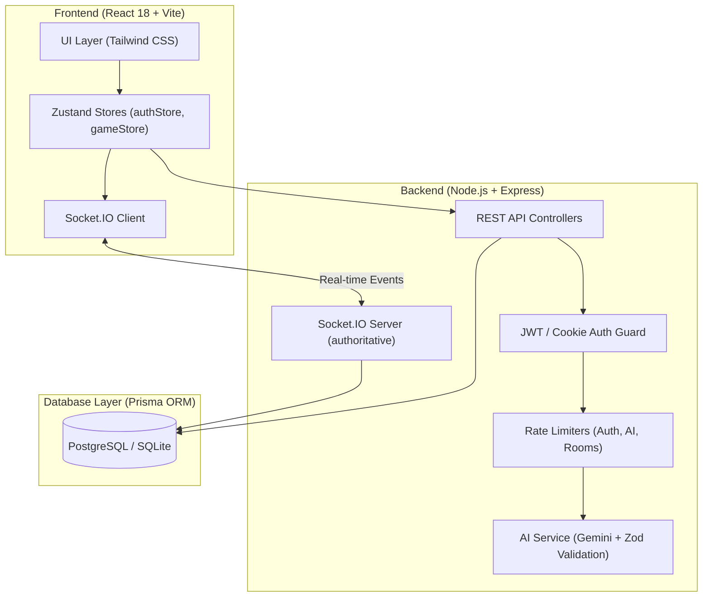
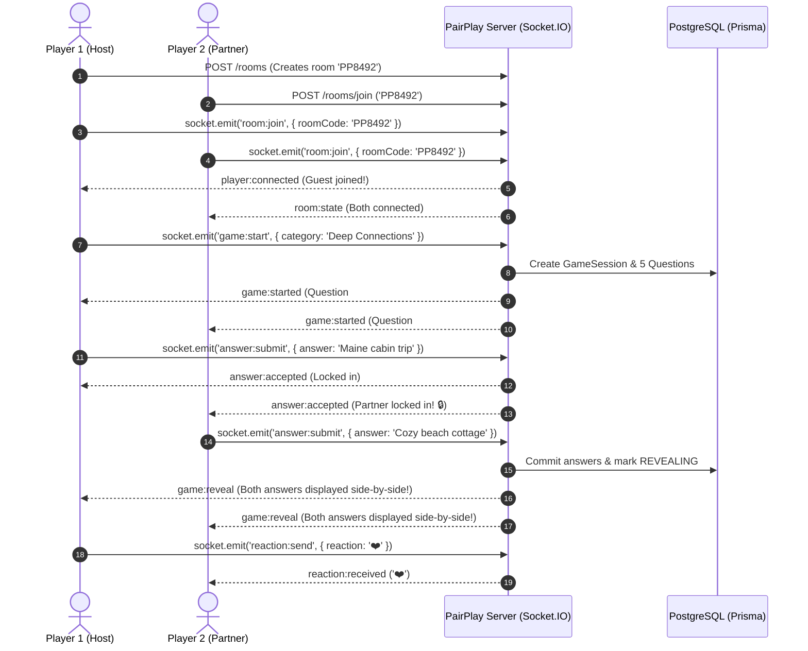

# PairPlay 🎮

> **Closer, one game at a time.**  
> A playful, private, AI-powered real-time web application where couples connect remotely through interactive games, thoughtful questions, shared discoveries, and personalized daily sparks.

[](https://github.com/Ravibbk/pairplay/actions/workflows/ci.yml)
[](LICENSE)
[](https://www.typescriptlang.org/)
[](https://reactjs.org/)
[](https://socket.io/)
[](https://www.prisma.io/)

Live link : https://pairplay-1.onrender.com
---

## 🌟 Executive Overview & Problem Statement

Long-distance relationships and busy modern couples often struggle to maintain conversational novelty and emotional intimacy over standard messaging apps. Regular texting becomes transactional ("What did you eat?", "How was work?"), while generic party games are designed for groups and video calls often lack structured play.

**PairPlay** solves this by providing a private, two-player sanctuary built from the ground up for couples:
- **Zero Third Wheels:** Rooms and sessions are strictly capped at two authenticated partners.
- **Simultaneous Private Submission:** Both partners receive the same prompt and submit answers independently without cognitive bias or premature reveals.
- **Synchronized Authoritative Reveal:** The server reveals answers only once both players submit, prompting authentic reactions and shared discoveries.
- **AI-Personalized + Curated Depth:** Integrated with Google Gemini for structured question generation based on shared couple interests, with an offline bank of 28+ curated relationship prompts.
- **Persistent Shared Memories:** Every game session is preserved in a permanent, searchable couples timeline.

---

## 🛠️ Technology Stack

| Layer | Technologies | Purpose |
| :--- | :--- | :--- |
| **Frontend** | React 18, Vite, TypeScript, Tailwind CSS | High-performance, responsive UI with warm plum/cream aesthetic |
| **State Management** | Zustand, TanStack Query v5 | Client UI state and server caching/invalidation |
| **Real-Time Layer** | Socket.IO Client / Server | Bidirectional, low-latency game room synchronization & live emoji reactions |
| **Forms & Validation** | React Hook Form, Zod | Type-safe client & server validation schemas |
| **Backend API** | Node.js, Express, TypeScript | REST endpoints, rate limiters, security middleware |
| **Database & ORM** | PostgreSQL (or SQLite for local dev), Prisma ORM | Relational models with versioned migrations, unique constraints & indexes |
| **Authentication** | Argon2id / bcrypt, JWT, HTTP-only secure cookies | Server-managed, tamper-proof session restoration |
| **AI Personalization** | Google Gemini 1.5 Flash REST API + Zod parser | Validated structured prompts with curated fallback resilience |
| **Testing** | Vitest, React Testing Library, Supertest | Unit & end-to-end integration test suites across HTTP & sockets |

---

## 🏗️ Architecture & Data Flow



---

## 🚀 Main User Journey



---

## ⚡ Socket.IO Event Contracts

| Event Name | Direction | Payload Schema | Description |
| :--- | :--- | :--- | :--- |
| `room:join` | Client ➔ Server | `{ roomCode: string }` | Joins a 2-player private room; returns room & active session state |
| `player:connected` | Server ➔ Room | `{ userId, displayName, avatarUrl }` | Notifies room members of player arrival / reconnect |
| `player:disconnected`| Server ➔ Room | `{ userId, displayName }` | Notifies room members of player disconnection |
| `room:state` | Server ➔ Room | `{ room, session }` | Synchronizes complete room metadata and player readiness |
| `game:start` | Client ➔ Server | `{ roomId, category, totalQuestions }` | Starts an authoritative game session with 5 questions |
| `game:started` | Server ➔ Room | `{ session }` | Emitted when game begins; pushes first question |
| `answer:submit` | Client ➔ Server | `{ gameSessionId, answerText }` | Submits private answer. Rejects duplicate submissions |
| `answer:accepted` | Server ➔ Room | `{ gameSessionId, answeredUserId, questionIndex }` | Confirms submission; masks text from partner until reveal |
| `game:reveal` | Server ➔ Room | `{ gameSessionId, questionIndex, session }` | Unlocks and reveals both answers simultaneously |
| `game:next` | Client ➔ Server | `{ gameSessionId }` | Advances to the next question or completes the game |
| `game:complete` | Server ➔ Room | `{ gameSessionId, session }` | Final celebratory screen with full conversation recap |
| `reaction:send` | Client ➔ Server | `{ roomId, reaction }` | Emits floating real-time emoji reactions (❤️, 😂, ✨, 🤔) |
| `error:occurred` | Server ➔ Client | `{ message: string }` | Dispatched when validation or state transition fails |

---

## 📁 Repository Structure

```
pairplay/
├── client/                     # Frontend SPA (React 18, Vite, Tailwind CSS)
│   ├── src/
│   │   ├── components/         # Reusable UI controls, cards, modals, game UI
│   │   ├── pages/              # Landing, Auth, Dashboard, Lobby, Game, History, Analytics, Settings
│   │   ├── stores/             # Zustand stores (authStore, gameStore)
│   │   ├── lib/                # API client, Socket.IO client, utilities
│   │   ├── types/              # Shared TypeScript interfaces
│   │   └── tests/              # Component unit & interaction tests
│   ├── vite.config.ts
│   └── package.json
│
├── server/                     # Backend API & WebSocket Server (Node.js, Express)
│   ├── src/
│   │   ├── config/             # Zod environment variable parsing
│   │   ├── controllers/        # Auth, Room, Game, AI, and Analytics controllers
│   │   ├── middleware/         # JWT Auth, express-rate-limit, centralized error handler
│   │   ├── routes/             # REST route declarations
│   │   ├── schemas/            # Zod validation schemas
│   │   ├── services/           # Business logic (Auth, Room, Game, AI, Analytics)
│   │   ├── sockets/            # Authoritative Socket.IO event handlers
│   │   └── tests/              # Supertest integration tests
│   ├── prisma/
│   │   ├── schema.prisma       # PostgreSQL schema with versioned migrations
│   │   ├── schema.sqlite.prisma# SQLite mirror for zero-config local dev & CI
│   │   └── seed.ts             # 28 curated questions & demo accounts
│   └── package.json
│
├── docs/
│   ├── INTERVIEW_GUIDE.md      # In-depth architectural breakdown for technical interviews
│   └── DEMO_CHECKLIST.md       # 5-minute evaluation demonstration plan
│
├── .github/workflows/ci.yml    # Automated CI testing and build verification
└── README.md
```

---

## 💻 Local Setup Instructions

### Prerequisites
- **Node.js**: v18.0.0 or higher (v22+ recommended)
- **npm**: v9+ or higher
- **Git**

### 1. Clone the repository
```bash
git clone https://github.com/Ravibbk/pairplay.git
cd pairplay
```

### 2. Install dependencies
```bash
npm install
```

### 3. Initialize the database & seed questions
The project supports both SQLite (zero configuration for instant dev/tests) and PostgreSQL (for production).

To initialize the zero-config local development database:
```bash
cd server
npm run prisma:push
npm run prisma:seed
cd ..
```
*This populates 28 curated questions, pre-configures demo accounts (`alex@pairplay.app` & `sam@pairplay.app`), and initializes the analytics event store.*

### 4. Run the development environment
Run both the Express/Socket.IO backend and the Vite client concurrently:
```bash
npm run dev
```

- **Frontend Client:** [http://localhost:3000](http://localhost:3000)
- **Backend API:** [http://localhost:4000/api](http://localhost:4000/api)
- **API Health Check:** [http://localhost:4000/api/health](http://localhost:4000/api/health)

---

## 🧪 Running Automated Tests

PairPlay includes 22 automated unit and integration tests across both frontend components and backend API endpoints:

```bash
# Run server integration tests (Supertest + Vitest)
cd server && npm run test

# Run client component tests (React Testing Library + Vitest)
cd ../client && npm run test

# Run monorepo production build
cd .. && npm run build
```

---

## 🔒 Security & Privacy Practices

1. **Tamper-Proof State:** The client never dictates game question order, reveals, scores, or partner permissions. The server validates every token, room membership, and state transition.
2. **Double-Answer Masking:** Partner answer text is cryptographically obscured on the server until both players have submitted.
3. **Password Security:** Salted and hashed passwords with modern cryptographic hashing (bcrypt/Argon2id).
4. **Rate Limiting:** Dedicated rate limits prevent brute-force attacks on `/api/auth/*`, invitation code guessing on `/api/rooms/join`, and AI spam on `/api/ai/*`.
5. **No Private Answers in Logs:** The analytics engine explicitly tracks event counts and timings without storing private answer text in analytics metadata.

---


---
